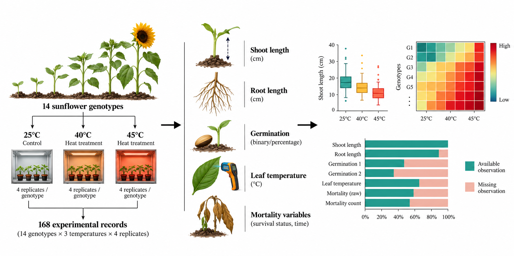
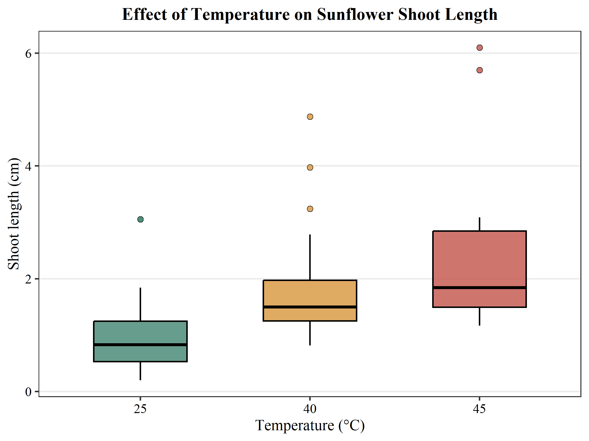
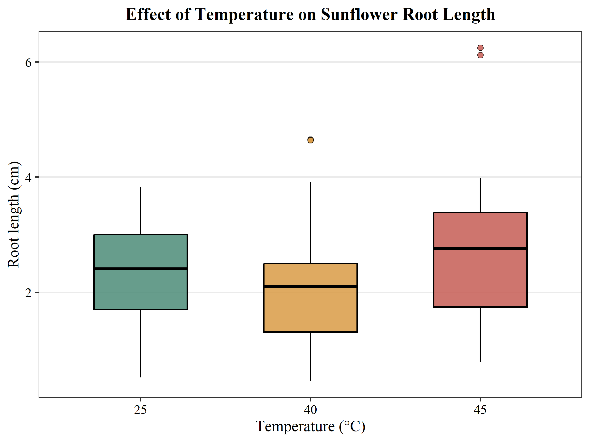
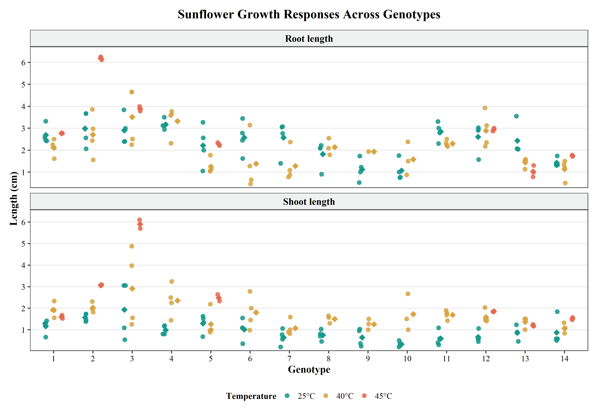
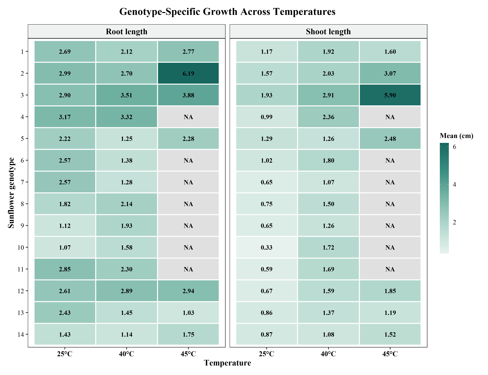
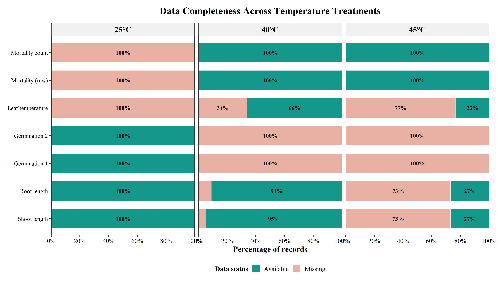

## Introduction

Temperature stress can influence seedling establishment and early plant growth. Understanding how sunflower genotypes respond to different temperature conditions is important for exploring variation in growth characteristics.

This study uses an experimental dataset of 14 sunflower genotypes evaluated under three temperature treatments (25°C, 40°C, and 45°C), with four replications per genotype–temperature combination.

The analysis focuses on shoot length, root length, genotype-level variation, and data completeness. Exploratory data analysis and scientific visualizations are used to identify patterns and assess limitations in the available measurements.

## Research Question

**How do sunflower seedling growth responses vary across temperature treatments and genotypes?**

### Objectives

1.  Compare observed shoot and root length distributions across temperature treatments.
2.  Explore variation in growth measurements among sunflower genotypes.
3.  Examine data completeness and its implications for interpreting temperature responses.

## Experimental Design and Dataset

The experimental dataset contains 168 records representing 14 sunflower genotypes evaluated at three temperatures (25°C, 40°C, and 45°C), with four replications per genotype–temperature combination.

The dataset was obtained from the Ayub Agricultural Research Institute (AARI), Pakistan, through a Research Officer associated with M.Phil. research.

The available variables include shoot length, root length, germination measurements, leaf temperature, and mortality-related measurements.

### Experimental Design and Analysis Workflow

*Figure 1. Overview of the sunflower experimental design, measured variables, and exploratory analysis workflow.*

## Descriptive Statistics

The following table summarizes observed shoot and root length measurements across temperature treatments. Values are presented as mean ± standard deviation (SD).

| Temperature | Shoot (N) | Shoot mean ± SD (cm) | Root (N) | Root mean ± SD (cm) |
|-------------|----------:|---------------------:|---------:|--------------------:|
| 25°C        |        56 |          0.95 ± 0.60 |       56 |         2.32 ± 0.87 |
| 40°C        |        53 |          1.69 ± 0.77 |       51 |         2.09 ± 1.02 |
| 45°C        |        15 |          2.43 ± 1.54 |       15 |         2.85 ± 1.64 |

*Note: N represents the number of non-missing observations. Mean and SD were calculated using available measurements.*

The number of available growth measurements declines substantially at 45°C. Therefore, comparisons across temperature treatments should be interpreted cautiously.

## Exploratory Data Analysis

### Shoot Length Across Temperatures

The observed mean shoot length increased from 0.95 cm at 25°C to 1.69 cm at 40°C and 2.43 cm at 45°C. However, the number of available measurements decreased substantially at 45°C, limiting direct comparisons.

*Figure 2. Distribution of observed sunflower shoot length across temperature treatments.*

### Root Length Across Temperatures

Mean root length was 2.32 cm at 25°C, 2.09 cm at 40°C, and 2.85 cm at 45°C. The differences in sample size and variability must be considered when interpreting these patterns.

*Figure 3. Distribution of observed sunflower root length across temperature treatments.*

### Preliminary Interpretation

Shoot and root length distributions vary across temperature treatments. Nevertheless, higher observed mean values at 45°C cannot be interpreted as evidence of improved growth or heat tolerance because many measurements are unavailable at this temperature.

### Genotype-Level Growth Variation

The observed growth measurements also varied among sunflower genotypes. Individual observations and mean patterns indicate that the response to temperature was not identical across all genotypes.

*Figure 4. Observed shoot and root length variation across sunflower genotypes and temperature treatments.*

### Genotype × Temperature Heatmap

To summarize genotype-specific responses, heatmaps were prepared using the mean of available measurements for each genotype–temperature combination.

*Figure 5. Mean observed shoot and root length across genotype–temperature combinations. Grey tiles indicate missing measurements.*

### Data Completeness Across Temperatures

Because the availability of measurements differed across variables and temperatures, a data completeness figure was used to show the percentage of available and missing records.

*Figure 6. Percentage of available and missing observations across variables and temperature treatments.*

## Discussion

The exploratory analysis suggests that sunflower growth responses differed across temperature treatments and genotypes. However, interpretation must be made cautiously because data completeness varied substantially across measurements.

In particular, shoot and root measurements were much less available at 45°C than at 25°C, and several variables were recorded only for particular temperature treatments. Therefore, higher observed means at 45°C should not be interpreted directly as evidence of superior growth or heat tolerance.

The genotype-level figures show visible variation among sunflower lines, but these results remain descriptive and exploratory.

## Conclusion

This report presents a first exploratory analysis of sunflower growth responses under temperature stress using experimental data from 14 genotypes and three temperature treatments.

The results indicate variation in observed shoot and root length across temperatures and among genotypes, while also highlighting the importance of data completeness in interpreting biological responses.

Future work should focus on clarifying the reasons for missing measurements, refining genotype comparisons, and extending the analysis with additional statistical methods where appropriate.
